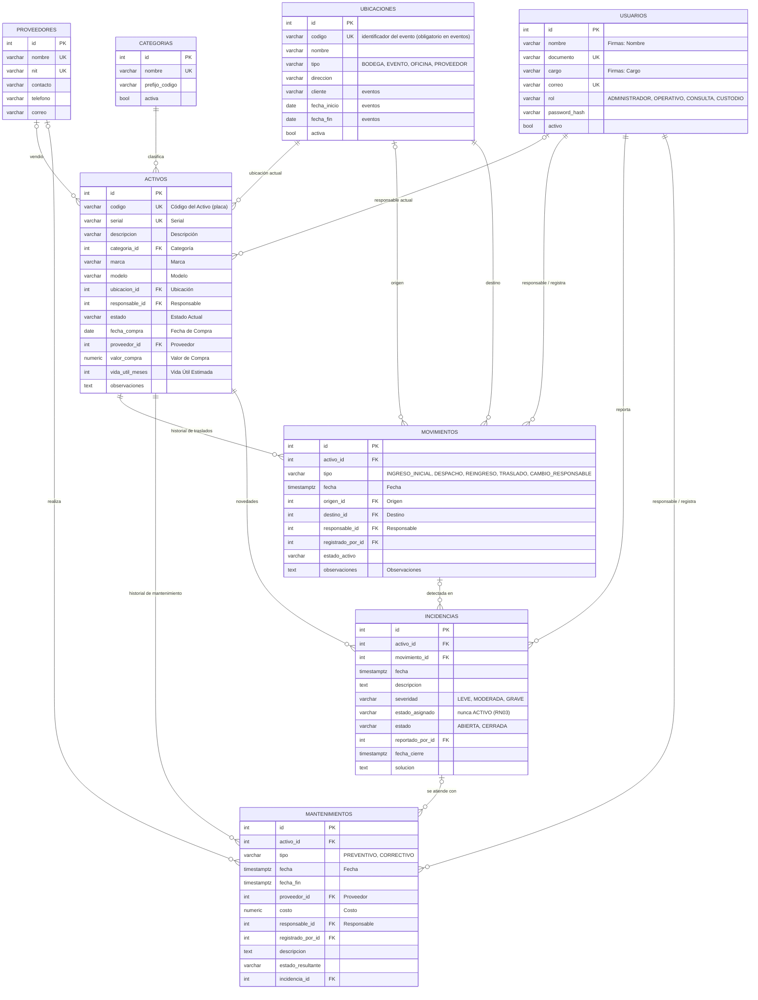

# Modelo entidad-relación

Basado en el formato **FOR-ADM-002 "Hoja de vida del activo"** de Instech y en los
requerimientos RF01–RF07 y reglas RN01–RN03 del documento de la práctica.

> En VS Code el diagrama se ve con la extensión *Markdown Preview Mermaid Support*
> (`Ctrl + Shift + V`). En GitHub se ve automáticamente.

## Correspondencia con el formato FOR-ADM-002

| Bloque del formato | Tabla |
|---|---|
| 1. Información general | `activos` (+ `categorias`, `proveedores`, `ubicaciones`, `usuarios`) |
| 2. Historial de mantenimiento | `mantenimientos` |
| 3. Historial de traslados | `movimientos` |
| 4. Firmas (nombre y cargo) | `usuarios` |
| — (requerido por el documento: incidencias) | `incidencias` |

## Estados del activo

Se usan los cuatro estados del formato de la empresa. Equivalencia con los del documento de la práctica:

| Formato FOR-ADM-002 | Documento de la práctica |
|---|---|
| Activo | Operativo |
| En Mantenimiento | En revisión |
| De Baja | De baja |
| Perdido / Hurtado | (nuevo) |

## Reglas que garantiza la base de datos

- Serial y código del activo únicos, sin distinguir mayúsculas y minúsculas.
- Solo se aceptan los valores definidos para estados, tipos y roles.
- Una incidencia nunca puede dejar el equipo en estado ACTIVO (RN03).
- Todo evento tiene un código identificador único (sin distinguir mayúsculas y minúsculas).
- Valores y costos no pueden ser negativos.
- Un activo con historial no se puede borrar: se da de baja (se conserva la trazabilidad, ISO/IEC 19770-1).
- Movimientos con fecha, responsable y usuario que registra obligatorios (RN02).

Las reglas que dependen del flujo (RN01: solo se despacha un activo en estado ACTIVO y que esté en bodega)
se aplican en la capa de negocio (`backend/app/services/`) en el siguiente sprint.
